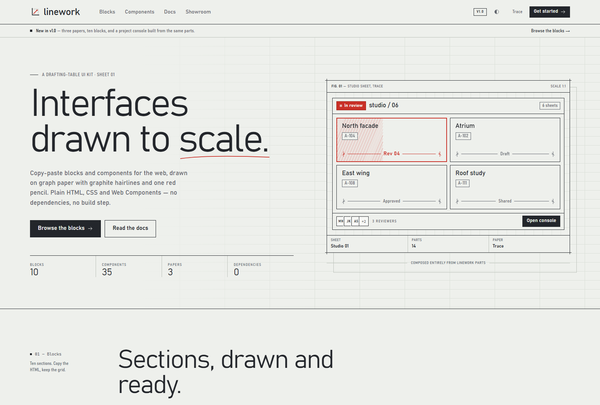
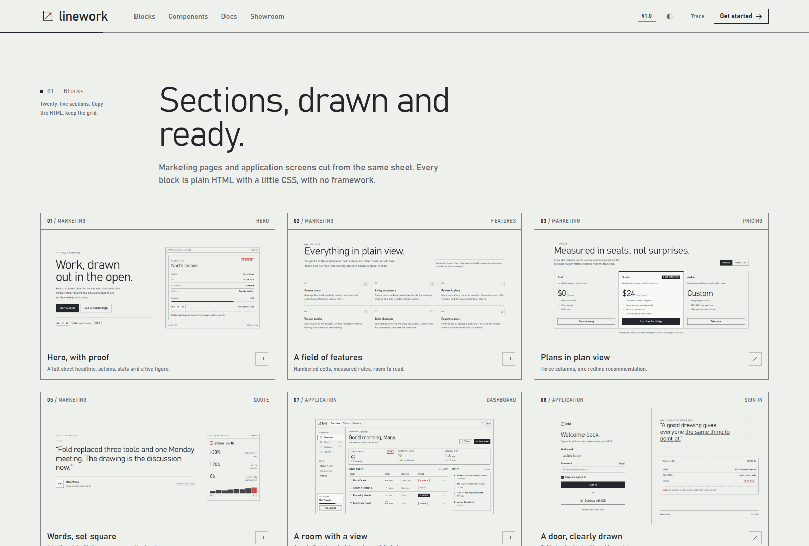
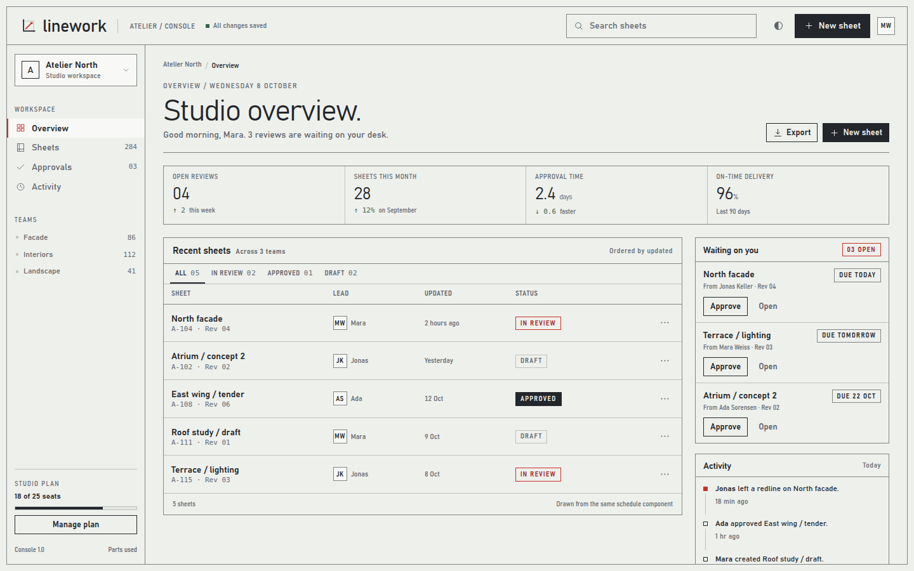

# Linework

A UI kit in the style of technical drawings: 51 components, 25 copy-paste blocks and three themes. Plain CSS and Web Components with no runtime dependencies and no build step, plus typed React wrappers.







Linework uses the visual language of architectural drawings: trace paper, a 24 px grid, hairline rules, dimension lines and title blocks. It ships as a CSS library, eight Web Components, 25 composed blocks, React wrappers and a documentation site built from the library itself.

## What is inside

| Piece | Detail |
| --- | --- |
| **CSS** | `linework.css`: tokens, base, layout, 51 components and utilities. 13.6 kB gzipped (minified). |
| **Blocks CSS** | `linework-blocks.css`: layout for the 25 blocks. 5.5 kB gzipped (minified). |
| **Behaviour** | `linework.js`: eight Web Components, icons, menus, toasts, themes, sorting and copy buttons. 16.5 kB gzipped. |
| **React** | `linework-ui/react`: typed wrappers for seven elements, with event props and refs. 1.7 kB gzipped. |
| **Themes** | Trace (light, default), Blueprint (dark) and Vellum (warm), defined entirely in tokens. |
| **Blocks** | Marketing: hero, header, logos, stats, process, features, comparison, pricing, team, testimonial, journal, changelog, FAQ, contact, newsletter, call to action and footer. Application: dashboard, onboarding, billing, members, review inbox, sign in, settings and not found. |
| **Components** | Forms: buttons, button groups, inputs, textareas, selects, search fields, fieldsets, checkboxes, radios, switches, ranges, segmented controls, steppers, combobox and calendar. Instruments: pads, dimension lines, keycaps, lamps, stamps, meters, progress bars, spinners and skeletons. Navigation: tabs, breadcrumbs, pagination, side navigation, steps and trees. Data: tables with sorting, spec lists, stats, activity feeds, setting rows, avatars, chips, file lists and code blocks. Overlays: menus, tooltips, dialogs, sheets, toasts and the command palette. Feedback: empty states, callouts, banners, accordions and dropzones. Plus 33 icons. |
| **Icons** | 33 icons in one inline SVG sprite. |
| **Fonts** | Barlow Semi Condensed, five latin woff2 weights under the SIL Open Font License, used only where Bahnschrift and DIN Alternate are missing. |
| **Pages** | Landing page, block gallery, component gallery, guide, an example project console and block previews. |

Windows uses Bahnschrift and macOS uses DIN Alternate. Every other platform downloads the bundled Barlow from `dist/fonts/`, next to the stylesheet. Nothing is loaded from a CDN.

## Quick start

Install the package, or copy `dist/` into your project and link the files:

```sh
npm install linework-ui
```

```html
<link rel="stylesheet" href="linework.css">
<script src="linework.global.js" defer></script>

<button class="lw-btn lw-btn--primary">New sheet</button>
<lw-pad name="Publish" keys="1" length="1.2 s"></lw-pad>
```

The script is optional for the class-based components, which render with HTML and CSS alone. The eight custom elements build their markup in the script: without it, `lw-pad`, `lw-meter`, `lw-command`, `lw-calendar` and `lw-drawer` render nothing, and `lw-tabs` and `lw-combobox` show their static children. The script also adds behaviour for menus, toasts, sorting, dismissing, steppers, theme switching and copy buttons. The global build exposes `window.Linework`. The ES module build, `linework.js`, is for bundlers:

```js
import 'linework-ui/style.css';
import Linework from 'linework-ui';
```

When you copy files by hand, keep `dist/fonts/` next to `linework.css`.

### React

```jsx
import 'linework-ui/style.css';
import { Drawer, Pad } from 'linework-ui/react';

export function Publish({ open, setOpen, run }) {
  return (
    <>
      <Pad name="Publish" keys="1" onPress={(event) => { event.preventDefault(); run(event.detail.pad); }} />
      <Drawer open={open} label="Publish" onClose={() => setOpen(false)}>
        <p>Ready to send revision 04.</p>
      </Drawer>
    </>
  );
}
```

`Drawer`, `Tabs`, `Pad`, `Meter`, `Combobox`, `Command` and `Calendar` take typed event props (`onPress`, `onChange`, `onSelect` and so on) whose `detail` is typed, forward refs to the element, and map booleans to attributes. React and React DOM 18 or later are optional peer dependencies.

### Blocks

Blocks need the block stylesheet as well:

```html
<link rel="stylesheet" href="linework.css">
<link rel="stylesheet" href="linework-blocks.css">
<script src="linework.global.js" defer></script>
```

Copy a block's markup from the gallery or from `docs/assets/js/blocks-data.js`. Blocks use `blk-*` layout classes; everything else is the component API.

## Run the site

Requires Node 18 or later. There are no npm packages to install.

```sh
npm start         # static server at http://127.0.0.1:4173/docs/
npm run build     # build dist/ and report gzip sizes
npm run capture   # screenshots for the README and gallery cards
```

The capture script drives Microsoft Edge through the Chrome DevTools Protocol. On macOS or Linux, set `LW_BROWSER` to a Chromium binary.

Pages after `npm start`:

- `/docs/`: landing page
- `/docs/blocks.html`: 25 blocks with live previews, copy and filters
- `/docs/components.html`: component gallery and tokens
- `/docs/docs.html`: guide covering install, tokens, themes, components, API, frameworks and accessibility
- `/docs/console.html`: example project console
- `/docs/preview.html?block=hero`: a single block

## Themes

All three themes set the same custom properties. Apply one to the root or to any container:

```html
<html data-theme="blueprint">
  ...
</html>

<section data-theme="vellum">
  ...
</section>
```

```js
Linework.setTheme('blueprint'); // saved to localStorage
Linework.getTheme();            // 'blueprint'
Linework.cycleTheme();          // next theme
```

Token groups:

- Surfaces: `--lw-paper`, `--lw-paper-lit`, `--lw-paper-deep`
- Ink: `--lw-ink`, `--lw-pencil`, `--lw-faint`
- Structure: `--lw-rule`, `--lw-line`, `--lw-grid`, `--lw-border`, `--lw-border-quiet`
- Signal: `--lw-redline`, `--lw-redline-deep`, used only for live, playing, destructive or focused states
- Type: `--lw-font-ui`, `--lw-font-display`, `--lw-font-narrow`, `--lw-font-mono`
- Space: `--lw-space-*`, named in pixels (`--lw-space-8` is 8 px)
- Motion: `--lw-duration-1` to `--lw-duration-5`, `--lw-ease`

A custom theme can be a few lines. Overrides on `:root` apply under every theme, including Blueprint; to change one theme only, scope them to `[data-theme="trace"]` or a theme name of your own.

```css
:root {
  --lw-paper: #f4f1e8;
  --lw-ink: #1e1c18;
  --lw-redline: #c93027;
  --lw-font-ui: "Barlow Semi Condensed", "Segoe UI", system-ui, sans-serif;
}
```

## Web Components

The elements render in the light DOM, so your CSS applies inside them.

| Element | Behaviour |
| --- | --- |
| `<lw-drawer>` | Side sheet on a native `<dialog>`, with focus trapping, Escape, backdrop and close control. |
| `<lw-tabs>` | Tabs with roving tabindex, arrow keys, Home/End and panels. |
| `<lw-pad>` | Action pad with progress, countdown, hatch and an optional menu key; `menu="id"` opens that `.lw-menu`. |
| `<lw-meter>` | ARIA meter drawn as a row of ticks, with an optional demo animation. |
| `<lw-combobox>` | Input with a filtered `.lw-listbox`, keyboard navigation and `aria-activedescendant`. |
| `<lw-command>` | Command palette in a native dialog, built from `.lw-command__item` children, with an optional Ctrl/Cmd shortcut. |
| `<lw-calendar>` | Month of day buttons with arrow, Home/End and Page Up/Down keys, `min`, `max` and `locale`. |
| `<lw-toast-stack>` | Popover live region used by `Linework.toast()`. |

```html
<button class="lw-btn" data-lw-open="add-sheet">New sheet</button>

<lw-drawer id="add-sheet" label="New sheet" width="460">
  <div class="lw-drawer__head"><h2 class="lw-drawer__title">New sheet</h2></div>
  <div class="lw-drawer__body">...</div>
  <div class="lw-drawer__foot">
    <button class="lw-btn lw-btn--primary" data-lw-close>Done</button>
  </div>
</lw-drawer>
```

The pad's `lw-press` event is cancelable. Call `preventDefault()` to drive the pad from a real operation; otherwise it runs its own timer.

## JavaScript API

```js
Linework.toast({
  title: 'Added',
  message: 'North facade is now on the schedule.',
  tone: 'success',
});

Linework.open('#new-sheet');
Linework.copy('...');
Linework.refresh(); // repaint range fills after dynamic content
```

Data attributes:

- `data-lw-open`: open a drawer or native dialog
- `data-lw-close`: close the nearest dialog or drawer
- `data-lw-theme`: set a theme, or `cycle`
- `data-lw-menu`: open a positioned menu
- `data-lw-copy` / `data-lw-copy-target`: copy a literal or an element's text
- `data-lw-tip`: supplementary CSS tooltip
- `data-lw-sort`: sortable table headers with `aria-sort`
- `data-lw-dismiss`: remove a chip, banner or file row and keep focus nearby
- `data-lw-step`: step the number input inside `.lw-stepper`

## Accessibility

Linework targets WCAG AA in all three themes:

- Native buttons, inputs, selects, checkboxes, radios and `<details>`.
- Visible dashed focus outlines with offset.
- Native modal dialogs for focus trapping and Escape.
- Keyboard support in tabs, menus and drawers, with no keyboard traps.
- Toasts in a polite live region that pauses on hover and focus.
- Reduced-motion support.
- AA contrast for body text, labels and secondary text, and 3:1 for control borders.

In your own pages, label every control, keep focus visible, do not use redline as the only signal, and test your content at 200% zoom.

## Project structure

```
src/css/        tokens, base, layout, components, blocks
src/js/         linework.js, the behaviour build
src/react/      React wrappers and their types
src/fonts/      bundled Barlow Semi Condensed and its licence
src/types/      TypeScript declarations
scripts/        build, static server and screenshots
dist/           built CSS, JS and types
docs/           site, blocks, components, guide and console example
docs/assets/    site CSS and JS, screenshots and block images
```

## Credits

The brand names in the blocks ("Fold", "Atelier North") are fictional. Barlow Semi Condensed is by the Barlow Project Authors and is bundled under the SIL Open Font License (`dist/fonts/OFL.txt`). No other third-party assets are bundled.

## License

MIT. See [LICENSE](LICENSE).
